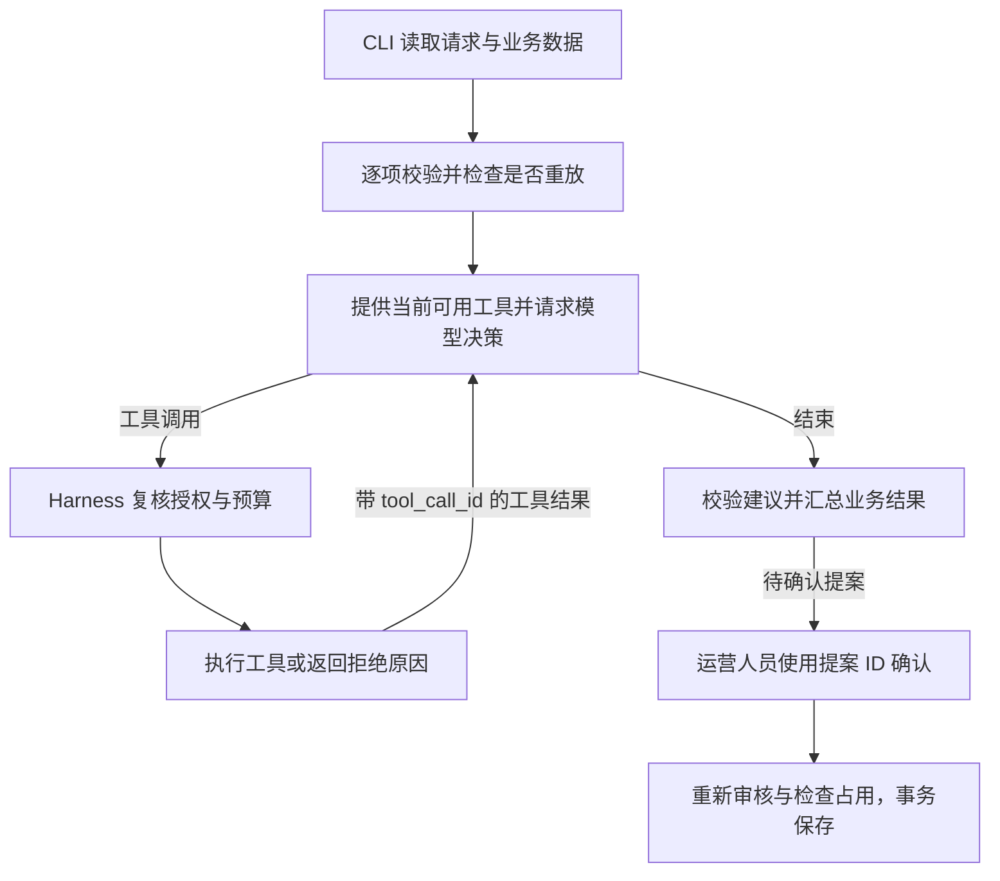

# 方案与取舍

## 组件和职责

| 组件 | 职责 |
| --- | --- |
| [CLI](../src/cli.ts) | 读取并校验请求、素材、规则和占用文件。提供 `run`、`confirm` 和 `inspect` 三个入口。 |
| [Agent](../src/agent.ts) 与 [模型适配器](../src/model.ts) | 逐项执行有界 ReAct 循环。真实模式向 DeepSeek 兼容接口请求工具调用，Mock 模式返回可复现的动作。 |
| [工具](../src/tools.ts) 与 [Harness](../src/harness.ts) | 定义工具输入、执行业务工具，并核对发给模型和执行前仍有效的工具权限。 |
| [领域规则](../src/domain.ts) | 校验素材必填字段、授权和渠道。规范化时点，生成请求指纹和候选时段。 |
| [SQLite](../src/store.ts) 与 [人工确认](../src/confirmation.ts) | 管理请求、占用、提案和草稿。确认入口重新审核并在事务内检查占用，返回真实保存回执。 |

## 调用流程与动态决策

1. `run` 将请求 ID 绑定到规范化请求的指纹。如果同一请求和素材已有草稿，直接返回已有回执。
2. 模型读取素材并调用审核工具。程序将每次工具返回和对应的 `tool_call_id` 加入消息列表，模型据此决定下一轮。
3. 审核通过后，模型可以查询原时段。若观察到 `AVAILABLE`，保存原时段的工具可用。若观察到 `OCCUPIED`，模型可发起 `query_slots(scope=alternatives)` 并返回候选。应用层仅接受实际查到且仍可用的候选，随后记录待确认提案。
4. 工具失败或资料不足时，输出具体原因和下一步建议。模型结束后，程序根据已获得的审核、占用和数据库回执生成结构化结果。

真实验收中，M01 的请求固定为 18:00。两个场景只改变该时段的占用，模型在后续回合分别请求保存与补查备选。轨迹保留工具参数、返回结果、下一步和依据。`basis` 根据工具事实生成。 [空闲轨迹](../examples/live/available.trace.jsonl) · [冲突轨迹](../examples/live/conflict.trace.jsonl)

## 工具权限、确认和存储

| 工具 | 授权与结果 |
| --- | --- |
| `get_asset` | 获取当前请求绑定的素材元数据。 |
| `check_rules` | 读取素材后开放。返回审核结果、规则版本和违规或缺失依据。 |
| `query_slots` | 审核通过后开放。先查原始时段，确认冲突后才允许查询备选范围。 |
| `save_draft` | 原始时段查询为空闲时开放。写入前复核审核和原始时间，并在事务内重查占用。 |

Harness 保存本轮工具权限快照，执行每个动作前再查询当前权限。模型如果在一条回复中夹带后续动作，系统会检查动作在回合开始时是否获准，以及执行时是否仍获准。首次保存成功或失败后，同一回复中的第二次保存会被拦截。Trace 的 `governance` 记录本轮开放的工具、当前工具、放行或拒绝原因和剩余调用预算。 [权限轨迹](../examples/harness-smoke/runs.jsonl)

改期提案绑定请求、素材、渠道、原始时段和候选时段。用户使用提案 ID 确认后，程序重新加载当前素材和规则，在 SQLite 事务内完成审核、检查占用、写草稿并回填提案回执。确认前被抢占时返回 `SLOT_TAKEN`，同一提案再次确认时返回原草稿 ID。 [确认成功](../examples/live/confirmation.output.json) · [确认前被抢占](../examples/mock/stale-confirmation.output.json)

SQLite 使用 `(channel, slot_utc)` 防止重复占用，使用 `(request_id, asset_id)` 防止同一素材在同一请求内重复保存。保存与确认的事务使用 `BEGIN IMMEDIATE`，写入失败时回滚。请求指纹包含素材、渠道、标准化时点和影响候选搜索的时区偏移。草稿成功以已提交的数据库回执为准。

每项最多 8 个模型回合、10 次工具调用尝试，默认模型超时为 35 秒。预算耗尽时，素材运行状态为 `incomplete`，`stopReason` 为 `BUDGET_EXHAUSTED`。保存状态独立记录，最后一次调用若已写入，结果保留 `saveStatus: saved` 和草稿 ID。批次中其他项已完成时，整体可返回 `partial`。

## 技术取舍

| 选择 | 理由与限制 |
| --- | --- |
| TypeScript CLI 和 Node 原生工具循环 | 入口便于运行和故障注入。外部依赖为零，模型协议、授权判定和业务工具都能直接检查。集成框架曾作为选项，当前采用小规模原生实现。 |
| 版本化 JSON 规则和工具返回 | 合成规则可审阅、可替换。明确的审核条件由程序执行，模型依据结果决定查询或结束。 |
| 本地 SQLite | 事务、唯一约束与跨进程重放适合单机交付。存储模型限定为离散时间点。 |
| Mock 与真实模式共用工具 | Mock 复现状态和故障路径。真实模式的轨迹用于验证模型是否根据观察改变动作。 |

排期读写分离、幂等参数绑定与轨迹断言采用了项目中列出的设计参考。 [Cal.com 排期](https://cal.com/docs/api-reference/v2/slots/get-available-time-slots-for-an-event-type) · [Stripe 幂等请求](https://docs.stripe.com/api/idempotent_requests) · [ADK 轨迹评测](https://codelabs.developers.google.com/adk-eval/instructions)
